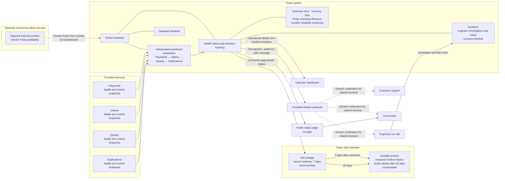

# Pulse — requirements and design plan

## 1. Purpose

Build **Pulse**, a system that checks the health of the provided service endpoints, reports service status, tracks incidents and recoveries, and presents the information through an operator dashboard and a public status page.

## 2. Services and monitoring priority

Monitor the provided services:

1. Payments
2. Claims
3. Quotes
4. Notifications

Schedule checks according to this priority, with independent schedulers: a check running for one service must not affect checks for the others.

Confirmed starting intervals:

| Service | Check interval |
| --- | ---: |
| Payments | 10 seconds |
| Claims | 15 seconds |
| Quotes | Lower priority than claims |
| Notifications | Lowest priority |

The check timing for quotes and notifications is to be set in accordance with their relative priority; no specific intervals were supplied.

Check service health endpoints and use the available control endpoints as relevant to understanding service status.

## 3. Health, incidents, and recovery

- Show each service's health status, including available/operational and degraded or unavailable conditions.
- Automatically start an incident when a service goes down.
- Let engineers look into an incident and add notes.
- When service health returns, mark the incident recovered/resolved and represent that recovery in the incident history and timeline. “Rollbacks” refers to incident recoveries.
- Provide an incident timeline for each incident.

## 4. Notifications and information boundaries

The notification audiences are:

- Engineers on call
- Customer support
- Consumers

Apply least privilege: provide each audience only important information appropriate to that audience. The supplied webhook receiver does not provide separate client-specific APIs, so use one generic, audience-safe notification message for that shared receiver. Keep the public status information appropriate for consumers.

## 5. Operator dashboard

Provide an operator dashboard that shows:

- All monitored services and their current statuses, including available and degraded/unavailable services
- Timestamps
- Response times
- Incident timelines and incident recoveries (“rollbacks”)
- Service reliability targets and how much reliability/error budget remains
- How quickly problems are detected and recovered
- How efficiently Pulse is checking the services

Do not include engineer acknowledgement time as a metric. “Time taken care of” means time until the service is confirmed recovered.

## 6. Reliability targets

Use a monthly measurement window and these per-service targets:

| Service | Monthly reliability target |
| --- | ---: |
| Payments | 99.9% |
| Claims | 99.9% |
| Quotes | 99% |
| Notifications | 99% |

Show the remaining reliability target/error budget for each service on the operator dashboard.

## 7. Public status page

Provide a status page consumers can read without logging in. Show service status in a customer-appropriate way, and do not expose information beyond what consumers need.

## 8. Technology, security, and operation

- Implement the backend in Python to make it easier for the user to debug; keep frontend parts separate.
- Design the whole system with a holistic security approach and least-privilege information access.
- In a deployed setup, run Pulse separately from the monitored services, preferably outside their host and failure domain, so a service-host outage does not also take down its monitor.
- If Pulse itself must be monitored, use an external monitor in another failure domain; a Pulse process cannot report its own host or network outage while it is unreachable.
- The complete system must be runnable with a single command.
- The README must explain how someone can run the system from scratch.

## 9. Data retention and storage

- Keep recent incidents in hot, readily queryable storage for 7 days.
- After 7 days, move resolved incident records and their timelines to durable persistent archive storage; older incident history must remain retrievable by operators.
- Keep open incidents in hot storage until they are resolved, even if they are older than 7 days.
- Keep recent probe data readily queryable for the operator dashboard.
- After 30 days, move older detailed probe data to a compressed archive rather than compressing the live database in place.
- Retain incident and recovery information needed for timelines and longer-term reliability reporting; use summaries where detailed old probe records are no longer needed for those reports.
- Make the retention period configurable so storage cost and historical detail can be balanced.

## 10. Design diagram

## 11. Run and README expectations

The README must provide the single command to start Pulse and the provided services, explain the service/status pages, and describe how to run the system from a fresh setup.
